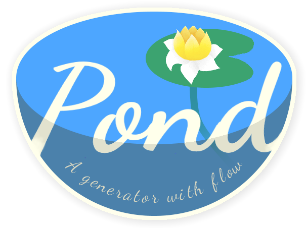

<div align="center">
  
</div>

# Pond

Pond builds a static HTML site from Markdown articles and reusable HTML templates.
Templates use C# expressions with `{{ ... }}`, plus `` and
`` blocks. The layout belongs in the template; the article content
stays in Markdown.

This repository contains a small, reproducible example. Pond remains an
experimental generator with a limited Markdown renderer, rather than a complete
publishing platform. See [project status](docs/status.md) for the supported scope
and its intended use relative to [typeset_md](https://github.com/WilliamRagstad/typeset_md).

## Build the example

Install the .NET SDK selected by [global.json](global.json) (8.0.426, or a later
patch in that feature band). From a clean checkout:

```sh
dotnet restore --locked-mode
dotnet build --no-restore
dotnet run --project Pond --no-build -- build examples/basic/config.json
```

Open `examples/basic/site/index.html` in a browser. Follow the guide and details
links to visit all three pages. The details page uses an alternate template and
the copied stylesheet. No server, JavaScript, or external assets are needed.

The [fixture](examples/basic) contains Markdown, two templates, CSS, and the exact
configuration used by the integration checks. To verify it with Python 3:

```sh
python tests/verify.py
```

The checks build in a temporary directory, follow local HTML links, compare output
hashes across clean and repeated builds, and exercise template and configuration
errors. CI runs these checks on Linux and Windows.

## CLI

```sh
dotnet run --project Pond -- --help
dotnet run --project Pond -- build examples/basic/config.json
dotnet run --project Pond -- build /c examples/basic/config.json
```

`Pond init` writes `config.json` and creates `articles`, `templates`, `style`, and
`site` in the current directory. It refuses to overwrite an existing config.
It creates empty directories, so add Markdown and `templates/index.html` before
building. When running from another directory, use an absolute path to the Pond
project or built DLL, for example `dotnet /path/to/Pond.dll init`.

Build paths are resolved relative to the configuration file, independently of the
working directory. Errors go to stderr and return exit code 1; success returns 0.
Use the source build above for this example; historical downloadable binaries do
not include these repairs.

Read the [configuration and template reference](docs/configuration.md) to create
your own site.

## License

[MIT](LICENSE).
